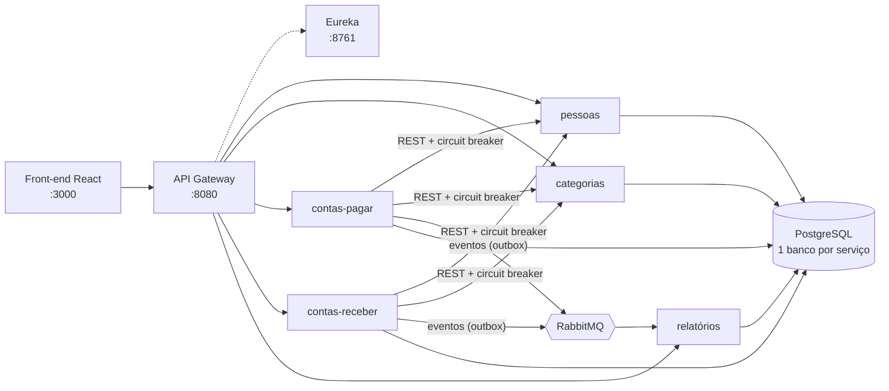

# CPR — Contas a Pagar e a Receber · Microsserviços

Sistema de contas a pagar e a receber baseado no livro *Delphi 4 — Contas a Pagar e a Receber* (Shiraishi & Côrtes), na **versão em microsserviços**: Spring Boot 3 + Spring Cloud, PostgreSQL, RabbitMQ e front-end React.

> Projeto Integrador — Sistemas Distribuídos · Etapa 2 (entrega 06/12/2026)
> Versão monolítica (etapa 1): https://github.com/guilherme22112/contas-a-pagar

**Equipe (6º Período TSI):** Guilherme Ribeiro dos Santos · Marcos Eduardo Graciano de Paula · João Pedro Moreira Inácio

## Arquitetura



| Serviço | Porta | Responsabilidade |
|---|---|---|
| `api-gateway` | 8080 | Entrada única, roteamento pelo Eureka, circuit breaker/fallback 503, Swagger unificado |
| `discovery-server` | 8761 | Registro e descoberta de serviços (Eureka) |
| `pessoas-service` | 8081 | Clientes e fornecedores |
| `categorias-service` | 8082 | Plano de contas hierárquico (RN01) |
| `contas-pagar-service` | 8083 | Títulos a pagar e pagamento (idempotente) |
| `contas-receber-service` | 8084 | Títulos a receber e recebimento (idempotente) |
| `relatorios-service` | 8085 | Fluxo de caixa e inadimplência, alimentados por eventos |
| `frontend` | 3000 | React + Nginx |

Documentação completa (os 19 itens do enunciado, diagramas e decisões): **[docs/DOCUMENTACAO.md](docs/DOCUMENTACAO.md)**

## Como executar

**Pré-requisito:** [Docker Desktop](https://www.docker.com/products/docker-desktop/) rodando. No Windows, o WSL2 precisa estar instalado (`wsl --install` num PowerShell de administrador). Não é preciso instalar Java, Maven, Node nem PostgreSQL.

```bash
git clone https://github.com/RATOKILLER/contas-a-pagar-microsservicos.git
cd contas-a-pagar-microsservicos
docker compose up -d --build
```

A primeira subida compila as imagens e leva alguns minutos. Depois disso, espere cerca de **1 minuto** até todos os serviços aparecerem no Eureka; antes disso, o gateway responde 503 (é o fallback funcionando).

| O quê | Endereço |
|---|---|
| **Sistema** | http://localhost:3000 |
| API (gateway) | http://localhost:8080/api/... |
| **Swagger de todas as APIs** | http://localhost:8080/swagger-ui.html |
| Eureka | http://localhost:8761 |
| RabbitMQ | http://localhost:15672 (usuário `cpr`, senha `cpr`) |
| Zipkin (rastreamento) | http://localhost:9411 |
| PostgreSQL | `localhost:5433` (bancos e usuários em [`infra/postgres/init.sql`](infra/postgres/init.sql)) |

Para parar: `docker compose down`. Para apagar também os dados: `docker compose down -v`.

### Roteiro rápido de demonstração

1. Em **Pessoas**, cadastre um fornecedor e um cliente. O plano de contas já vem com uma carga inicial.
2. Em **Contas a Pagar**, lance um título com desconto e validade e registre o pagamento. A prévia mostra o valor efetivo (RN05).
3. Abra **Relatórios**: o pagamento aparece em segundos, levado por um evento.
4. Rode `docker compose stop pessoas-service` e tente lançar um título: ele é recusado com 503 e a listagem continua funcionando. Rode `docker compose start pessoas-service` para voltar.
5. Rode `docker compose stop rabbitmq`, pague um título, depois `docker compose start rabbitmq`: o relatório se atualiza sozinho, porque o evento estava guardado no outbox.
6. No **Zipkin**, procure `contas-pagar-service`: o mesmo traceId passa pelo gateway, por contas e por pessoas.

## Testes

```bash
./mvnw verify          # Windows: mvnw.cmd verify   (requer JDK 21 e Docker para o Testcontainers)
```

São 62 testes automatizados: regras de negócio, controllers, integração com PostgreSQL real, idempotência e duplicidade de eventos. Há também 9 cenários manuais de falha (serviço fora do ar, broker fora do ar). Cenários, dados e evidências: **[docs/TESTES.md](docs/TESTES.md)**. A coleção do Postman está em [`docs/api/CPR.postman_collection.json`](docs/api/CPR.postman_collection.json).

## Estrutura do repositório

```
├── api-gateway/              Spring Cloud Gateway
├── discovery-server/         Eureka
├── pessoas-service/          ┐
├── categorias-service/       │  cada um: pom.xml, Dockerfile, src/main (api, service, domain,
├── contas-pagar-service/     │  integracao, evento, shared), src/main/resources/db/migration (Flyway)
├── contas-receber-service/   │  e src/test
├── relatorios-service/       ┘
├── frontend/                 React + Vite + TypeScript (React Router, TanStack Query, RHF + Zod, Recharts, Sonner)
├── infra/postgres/init.sql   criação dos 5 bancos e usuários
├── docs/                     documentação, diagramas, testes e coleção Postman
├── docker-compose.yml        sobe tudo com um comando
└── pom.xml                   agregador (só para compilar/testar tudo de uma vez)
```

## Desenvolvimento local (opcional)

Para rodar um serviço fora do Docker, suba só a infraestrutura com `docker compose up -d postgres rabbitmq zipkin discovery-server api-gateway` e execute o serviço pela IDE ou com `./mvnw -f pessoas-service/pom.xml spring-boot:run`. Os valores padrão do `application.yml` já apontam para `localhost`. O front-end roda com `cd frontend && npm install && npm run dev` (Vite em :5173, com proxy para o gateway).
