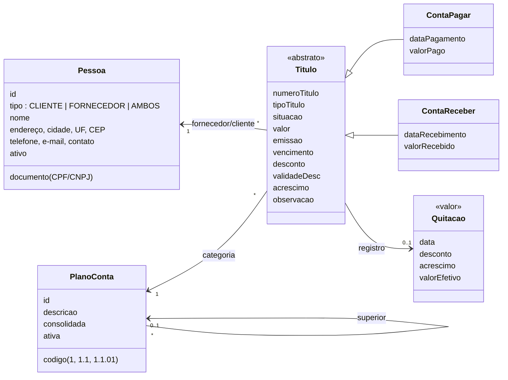
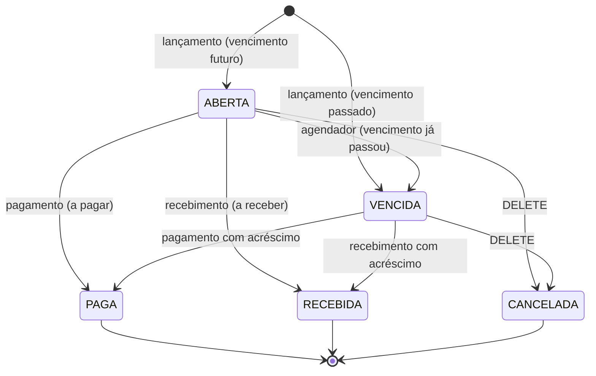
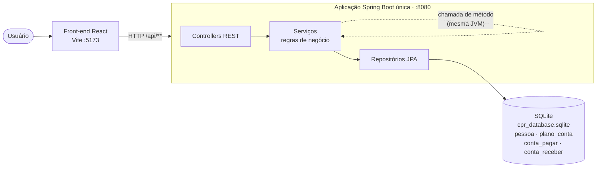
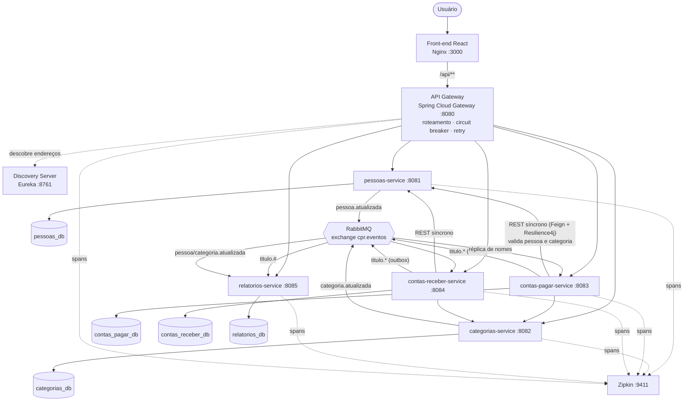
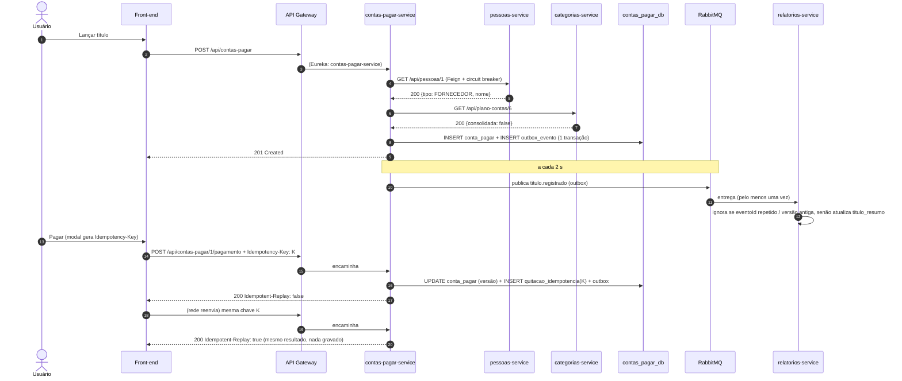

# CPR — Contas a Pagar e a Receber · Documentação do Projeto

**Disciplina:** Sistemas Distribuídos · Projeto Integrador — Atualização de um Sistema Legado
**Etapa 2:** da aplicação monolítica à arquitetura de microsserviços (entrega em 06/12/2026)
**Repositório da versão monolítica:** https://github.com/guilherme22112/contas-a-pagar
**Repositório da versão em microsserviços:** https://github.com/RATOKILLER/contas-a-pagar-microsservicos
**Fonte das regras de negócio:** *Delphi 4 — Contas a Pagar e a Receber*, Kazuhiro Shiraishi e Pedro Luiz Côrtes (Érica).

> Os diagramas estão em Mermaid: o GitHub os desenha direto nesta página. Os diagramas de cada arquitetura
> estão em [diagramas-monolito.md](diagramas-monolito.md) e [diagramas-microsservicos.md](diagramas-microsservicos.md).
> Os testes, com cenário, dados e resultado, estão em [TESTES.md](TESTES.md).

## Sumário

1. [Descrição do problema](#1-descrição-do-problema)
2. [Objetivos da aplicação](#2-objetivos-da-aplicação)
3. [Regras de negócio](#3-regras-de-negócio)
4. [Requisitos funcionais](#4-requisitos-funcionais)
5. [Requisitos não funcionais](#5-requisitos-não-funcionais)
6. [Principais funcionalidades](#6-principais-funcionalidades)
7. [Modelo de domínio](#7-modelo-de-domínio)
8. [Arquitetura monolítica](#8-arquitetura-monolítica)
9. [Arquitetura de microsserviços](#9-arquitetura-de-microsserviços)
10. [Justificativa da divisão dos serviços](#10-justificativa-da-divisão-dos-serviços)
11. [Descrição das APIs](#11-descrição-das-apis)
12. [Estratégia de persistência](#12-estratégia-de-persistência)
13. [Comunicação entre os serviços](#13-comunicação-entre-os-serviços)
14. [Tratamento de falhas](#14-tratamento-de-falhas)
15. [Procedimentos para executar a aplicação](#15-procedimentos-para-executar-a-aplicação)
16. [Testes realizados](#16-testes-realizados)
17. [Dificuldades encontradas](#17-dificuldades-encontradas)
18. [Comparação entre as duas arquiteturas](#18-comparação-entre-as-duas-arquiteturas)
19. [Conclusão da equipe](#19-conclusão-da-equipe)

---

## 1. Descrição do problema

Uma organização precisa controlar o que tem a pagar a fornecedores e o que tem a receber de clientes: quando vence, quanto vale, se já foi quitado, com que desconto ou acréscimo, e como fica o caixa nos próximos meses. O sistema de referência é o do livro de Shiraishi, escrito em Delphi 4 com 13 tabelas Paradox e uso local, para um único usuário.

O trabalho moderniza esse sistema legado em duas etapas:

1. **Monólito web** em Java/Spring Boot com API REST e front-end React (entregue em 04/10/2026).
2. **Microsserviços:** o mesmo domínio dividido em serviços independentes, cada um com o próprio banco, comunicando-se pela rede (esta entrega).

O desafio da segunda etapa vai além de separar o código em projetos. É preciso decidir quem é dono de cada dado, como um serviço confirma informações de outro e o que acontece quando um deles cai. Também é preciso evitar que uma quitação seja registrada duas vezes e manter os relatórios coerentes quando cada serviço tem a sua base.

## 2. Objetivos da aplicação

- Cadastrar **pessoas** (clientes, fornecedores ou ambos) e o **plano de contas** hierárquico (categorias financeiras).
- Lançar, alterar e cancelar **títulos a pagar e a receber**, com tipo, valores, datas, desconto com validade e acréscimo.
- **Registrar a quitação** (pagamento ou recebimento), mantendo o histórico para consultas e relatórios.
- **Consultar** títulos por período de vencimento, situação e pessoa.
- Gerar **relatórios**: fluxo de caixa previsto x realizado por mês e inadimplência.
- Na etapa 2, mostrar na prática:
  - autonomia de dados;
  - comunicação síncrona e assíncrona;
  - tolerância a falhas;
  - idempotência;
  - rastreamento distribuído;
  - consistência eventual.

## 3. Regras de negócio

Extraídas do capítulo 3 (*O Manual do Sistema*) e do capítulo 5 do livro. As marcadas com **(G)** são extensões do grupo.

| Código | Regra | Fonte | Onde é garantida (microsserviços) |
|---|---|---|---|
| RN01 | Plano de contas hierárquico. Conta **consolidada** agrupa outras e **não recebe título**; só conta consolidada pode ser superior. | cap. 3, p. 48–49 | `categorias-service` (superior consolidada); `contas-*-service` (recusa categoria consolidada) |
| RN02 | Lançamento por partida dobrada (crédito/débito). | cap. 3, p. 50–51 | Fora do escopo implementado; ver seção 17 |
| RN03 | Despesa é previsão; o título é o valor exato com vencimento. | cap. 3, p. 51 e 55 | Título com valor e vencimento obrigatórios |
| RN04 | Não se lança título para pessoa inexistente; a pessoa vem de cadastro prévio. Título a pagar exige **fornecedor** e título a receber exige **cliente** (ou AMBOS). | cap. 3, p. 56 | `contas-*-service` consulta o `pessoas-service` por REST antes de gravar |
| RN05 | Desconto tem prazo de validade: dentro do prazo aplica-se o desconto; fora dele, o acréscimo. **Valor efetivo = valor − desconto + acréscimo.** | cap. 3, p. 60 | `ContaPagarService.quitar` / `ContaReceberService.quitar` |
| RN06 | Tipo do título obrigatório: Duplicata, Nota Promissória, Outros **(G: + PIX e Cartão)**. | cap. 3, p. 60 | Enum `TipoTitulo` + validação |
| RN07 | Quitação é registro, não exclusão: o título permanece para consulta. **(G)** "Excluir" um título em aberto = **cancelar** (situação CANCELADA). | cap. 3, p. 60 | `DELETE` cancela; título pago/cancelado não pode ser alterado |
| RN08 | Cheque pré-datado. | cap. 3, p. 61 | Não implementado (seção 17) |
| RN09 | Remessa para cartório. | cap. 3, p. 62 | Não implementado (seção 17) |
| RN10 | Toda exclusão pede confirmação. | cap. 3, p. 48 e 54 | Front-end: diálogo de confirmação |
| RN11 **(G)** | Situação explícita: ABERTA, PAGA, RECEBIDA, VENCIDA, CANCELADA. Título em aberto com vencimento passado vira **VENCIDA** (agendador de hora em hora e ao lançar). | o livro deduzia pelas datas | `VencimentoAgendador` |
| RN12 **(G)** | Vencimento ≥ emissão; desconto < valor; validade do desconto só com desconto; quitação não pode ter data futura nem anterior à emissão. | — | Bean Validation + serviço + Zod no front-end |
| RN13 **(G)** | Número do título único por natureza; documento (CPF/CNPJ) único por pessoa; código único no plano. | — | Constraints `UNIQUE` + validação no serviço |
| RN14 **(G)** | Uma quitação nunca é aplicada duas vezes (idempotência pela chave `Idempotency-Key`). | — | Tabela `quitacao_idempotencia` + trava otimista |

## 4. Requisitos funcionais

| ID | Requisito |
|---|---|
| RF01 | Cadastrar, consultar, alterar e excluir (logicamente) pessoas, com filtro por tipo e nome. |
| RF02 | Cadastrar, consultar, alterar e excluir contas do plano de contas, com conta superior. |
| RF03 | Lançar, consultar, alterar e cancelar títulos a pagar. |
| RF04 | Lançar, consultar, alterar e cancelar títulos a receber. |
| RF05 | Registrar o pagamento de um título a pagar (data, desconto, acréscimo). |
| RF06 | Registrar o recebimento de um título a receber. |
| RF07 | Consultar títulos por período de vencimento, situação e pessoa. |
| RF08 | Emitir o fluxo de caixa mensal previsto x realizado de um período. |
| RF09 | Listar títulos em atraso (inadimplência de clientes e contas a pagar atrasadas). |
| RF10 | Marcar automaticamente como vencidos os títulos em aberto com vencimento passado. |
| RF11 | Exibir dashboard com totais a pagar, a receber, saldo e próximos vencimentos. |

## 5. Requisitos não funcionais

| ID | Requisito | Como foi atendido |
|---|---|---|
| RNF01 | API REST documentada | OpenAPI/Swagger em cada serviço, unificado no gateway (`/swagger-ui.html`) |
| RNF02 | Validação e erros padronizados | Mesmo formato `ErroResposta` em todos os serviços e no gateway; 400/404/409/422/503 |
| RNF03 | Autonomia de dados | Um banco PostgreSQL e um usuário por serviço; nenhum serviço lê a base de outro |
| RNF04 | Disponibilidade parcial | Circuit breaker no gateway e nas chamadas Feign; queda de um serviço não derruba os outros |
| RNF05 | Entrega confiável de eventos | Padrão outbox + consumidor idempotente + fila de erro (DLQ) |
| RNF06 | Rastreabilidade | Micrometer Tracing + Zipkin; `traceId` em todos os logs |
| RNF07 | Execução com um comando | `docker compose up -d --build` |
| RNF08 | Versionamento de schema | Flyway em cada serviço; `ddl-auto=validate` |
| RNF09 | Testes automatizados | 62 testes (unitários, controller, integração com Testcontainers) |
| RNF10 | Usabilidade | Front-end React com validação no campo (React Hook Form + Zod), rotas por URL e notificações |

## 6. Principais funcionalidades

- **Cadastros:** pessoas, com documento normalizado (só dígitos) e exclusão lógica, e plano de contas em árvore, com carga inicial.
- **Títulos:** lançamento com validação da pessoa e da categoria nos serviços donos desses dados. O título já nasce VENCIDO quando o vencimento passou.
- **Quitação:** cálculo automático de desconto e acréscimo pela data (RN05), prévia do valor efetivo no front-end e idempotência contra cliques duplos ou reenvio da rede.
- **Consultas:** filtros por período, situação e pessoa.
- **Relatórios:** fluxo de caixa mensal (previsto pelo vencimento, realizado pela quitação) e inadimplência com dias em atraso.
- **Observabilidade:**
  - Eureka mostra os serviços no ar;
  - Zipkin mostra o caminho de cada requisição;
  - o painel do RabbitMQ mostra as filas;
  - o actuator mostra o estado dos circuit breakers.

## 7. Modelo de domínio



As **situações** do título e suas transições:



## 8. Arquitetura monolítica

*(Entregue na etapa 1 — repositório `guilherme22112/contas-a-pagar`.)*

Uma aplicação Spring Boot 3.3 (Java 21) num único processo na porta 8080, com um banco SQLite (`cpr_database.sqlite`). O código é organizado **por domínio** (`pessoa`, `planoconta`, `contapagar`, `contareceber`, `shared`), com camadas Controller → Service → Repository → Entidade dentro de cada pacote. O front-end React (Vite) consome a API em `/api/**`.



Características:
- Os serviços chamam uns aos outros como métodos Java. Por exemplo, `ContaPagarService` chama `PessoaService.buscarPorId`.
- As chaves estrangeiras são reais: `conta_pagar.pessoa_id` referencia `pessoa.id`.
- Uma única transação cobre tudo.
- Um único deploy: qualquer mudança exige subir o sistema inteiro de novo.

Os diagramas de classes, componentes, pacotes, casos de uso, sequência e DER do monólito estão em [diagramas-monolito.md](diagramas-monolito.md).

## 9. Arquitetura de microsserviços



| Componente | Tecnologia | Responsabilidade |
|---|---|---|
| `api-gateway` | Spring Cloud Gateway | Entrada única; roteia `/api/**` pelo nome no Eureka; circuit breaker e fallback 503 por rota; retry só em GET; Swagger unificado |
| `discovery-server` | Netflix Eureka | Registro de serviços: ninguém guarda IP ou porta de outro |
| `pessoas-service` | Spring Boot + PostgreSQL | Dono dos dados de clientes/fornecedores; publica `pessoa.atualizada` |
| `categorias-service` | Spring Boot + PostgreSQL | Dono do plano de contas; aplica RN01; publica `categoria.atualizada` |
| `contas-pagar-service` | Spring Boot + PostgreSQL + Feign | Títulos a pagar e pagamento; valida pessoa/categoria; outbox de eventos |
| `contas-receber-service` | Spring Boot + PostgreSQL + Feign | Espelho para títulos a receber e recebimento |
| `relatorios-service` | Spring Boot + PostgreSQL | Modelo de leitura alimentado por eventos; fluxo de caixa e inadimplência |
| `rabbitmq` | RabbitMQ 3.13 | Mensageria assíncrona (exchange tópico `cpr.eventos`, DLQ) |
| `postgres` | PostgreSQL 16 | Uma instância, **cinco bancos e cinco usuários isolados** |
| `zipkin` | Zipkin 3 | Rastreamento distribuído |
| `frontend` | React + Nginx | Interface; Nginx repassa `/api` ao gateway |

Os diagramas de classes, componentes, pacotes, casos de uso, sequência e DER desta versão estão em [diagramas-microsservicos.md](diagramas-microsservicos.md).

## 10. Justificativa da divisão dos serviços

Seguimos a sugestão do enunciado (pessoas, categorias, contas a pagar, contas a receber e relatórios) porque ela coincide com os **contextos de negócio** do livro e com os pacotes que o monólito já tinha. Organizar o monólito por domínio na etapa 1 foi o que tornou a divisão quase mecânica. Para cada serviço, a pergunta foi: **quem é o dono deste dado e quem precisa dele?**

| Serviço | Por que é um serviço separado | Depende de |
|---|---|---|
| Pessoas | Cadastro de referência usado pelas duas naturezas de título; muda pouco e é lido muito. É o "Cliente.db/Fornecedor.db" do livro. | Ninguém |
| Categorias | Estrutura contábil própria, com regra própria (RN01) e ciclo de vida independente dos títulos. | Ninguém |
| Contas a pagar | Concentra o ciclo de vida do título a pagar (lançar → vencer → pagar/cancelar) e a regra de quitação. | Pessoas e Categorias (só para **validar** no lançamento) |
| Contas a receber | Mesmo ciclo, mas outro processo de negócio, outros usuários (financeiro x cobrança) e evolução diferente: o livro prevê cheque pré-datado e cartório só para recebimentos. | Pessoas e Categorias |
| Relatórios | Só lê, cruza pagar **e** receber e pode ficar segundos atrasado. Separá-lo evita que consultas pesadas disputem recursos com as gravações e que contas a pagar dependa de contas a receber. | Ninguém (recebe eventos) |

Decisões e alternativas consideradas:

- **Por que não juntar contas a pagar e a receber num serviço só?** Reduziria a duplicação (os dois serviços são parecidos). Mas o enunciado sugere separar, e as duas naturezas evoluem de forma diferente (RN08 e RN09 só existem para recebimento). Escala e falhas também ficam independentes: se o recebimento cair, o pagamento continua. Assumimos a duplicação de código, consciente e documentada, como custo da autonomia.
- **Por que relatórios não consulta os outros serviços na hora?** Montar um fluxo de caixa chamando dois serviços a cada consulta acoplaria a disponibilidade do relatório à deles e multiplicaria as chamadas. Com eventos, o relatório funciona mesmo com os serviços de contas fora do ar, e o preço é a consistência eventual.
- **Por que gateway e Eureka?** O front-end precisa de um endereço único, e os serviços precisam se achar sem configurar IPs. Na prática, isso responde às perguntas do enunciado *"como um serviço identifica outro?"* e *"o que acontece quando um serviço está indisponível?"*.

## 11. Descrição das APIs

Todas as rotas passam pelo gateway em `http://localhost:8080`. A documentação interativa fica em **http://localhost:8080/swagger-ui.html**, com um seletor por serviço, e cada serviço também expõe `/v3/api-docs`. A coleção do Postman está em [`docs/api/CPR.postman_collection.json`](api/CPR.postman_collection.json).

| Serviço | Método | Rota | Descrição | Respostas |
|---|---|---|---|---|
| pessoas | GET | `/api/pessoas?tipo=&nome=` | Lista pessoas ativas (AMBOS aparece nos dois tipos) | 200 |
| pessoas | GET | `/api/pessoas/{id}` | Detalha pessoa ativa | 200, 404 |
| pessoas | POST | `/api/pessoas` | Cadastra | 201, 400, 422 |
| pessoas | PUT | `/api/pessoas/{id}` | Altera (publica `pessoa.atualizada`) | 200, 400, 404, 422 |
| pessoas | DELETE | `/api/pessoas/{id}` | Exclusão lógica | 204, 404 |
| categorias | GET | `/api/plano-contas` | Lista em ordem de código | 200 |
| categorias | GET | `/api/plano-contas/{id}` | Detalha | 200, 404 |
| categorias | POST / PUT | `/api/plano-contas[/{id}]` | Cadastra / altera (superior deve ser consolidada) | 201/200, 400, 422 |
| categorias | DELETE | `/api/plano-contas/{id}` | Inativa (recusa se tiver subcontas) | 204, 422 |
| contas-pagar | GET | `/api/contas-pagar?inicio=&fim=&situacao=&pessoaId=` | Lista com filtros | 200, 422 |
| contas-pagar | GET | `/api/contas-pagar/{id}` | Detalha | 200, 404 |
| contas-pagar | POST | `/api/contas-pagar` | Lança título | 201, 400, 422, **503** |
| contas-pagar | PUT | `/api/contas-pagar/{id}` | Altera título em aberto | 200, 400, 404, 422, 503 |
| contas-pagar | DELETE | `/api/contas-pagar/{id}` | **Cancela** (não apaga) | 204, 404, 422 |
| contas-pagar | POST | `/api/contas-pagar/{id}/pagamento` | Pagamento; header `Idempotency-Key` | 200 (`Idempotent-Replay`), 400, 404, 409, 422 |
| contas-receber | — | `/api/contas-receber/**` | Espelho; quitação em `/{id}/recebimento` | idem |
| relatórios | GET | `/api/relatorios/fluxo-caixa?inicio=&fim=` | Previsto x realizado por mês | 200, 422 |
| relatórios | GET | `/api/relatorios/inadimplencia?natureza=RECEBER\|PAGAR` | Títulos em atraso com dias de atraso | 200, 422 |

Exemplo — lançar e pagar:

```http
POST /api/contas-pagar
Content-Type: application/json

{ "numeroTitulo": "CP-1", "pessoa": { "id": 1 }, "planoConta": { "id": 6 },
  "tipoTitulo": "DUPLICATA", "valor": 1000.00, "emissao": "2026-11-01",
  "vencimento": "2026-12-10", "desconto": 50.00, "validadeDesc": "2026-11-30", "acrescimo": 20.00 }

POST /api/contas-pagar/1/pagamento
Idempotency-Key: 6f1c0a3e-...           ← o front-end gera ao abrir o modal
{ "data": "2026-11-23" }                  ← sem desconto/acréscimo: calculados pela data (RN05)

→ 200  Idempotent-Replay: false   { ..., "situacao": "PAGA", "valorPago": 950.00 }
```

Formato único de erro (todos os serviços e o gateway):

```json
{ "timestamp": "2026-11-23T19:24:17Z", "status": 422, "erro": "REGRA_NEGOCIO",
  "mensagem": "A conta 2 é consolidada e não pode receber títulos; escolha uma subconta.", "campos": [] }
```

| Status | `erro` | Quando |
|---|---|---|
| 400 | `FALHA_VALIDACAO` / `REQUISICAO_INVALIDA` | Campo obrigatório, formato, JSON ou enum inválido (`campos` lista cada um) |
| 404 | `NAO_ENCONTRADO` | Registro inexistente ou inativo |
| 409 | `CONFLITO_DE_DADOS` / `CONFLITO_CONCORRENCIA` | Violação de unicidade no banco; duas operações simultâneas no mesmo título |
| 422 | `REGRA_NEGOCIO` | Regra violada (RN01–RN14) |
| 503 | `SERVICO_INDISPONIVEL` | Serviço chamado (ou roteado) fora do ar / circuito aberto |

## 12. Estratégia de persistência

**Monólito:** um banco SQLite com as quatro tabelas, chaves estrangeiras reais e schema gerado pelo Hibernate (`ddl-auto=update`).

**Microsserviços — *database per service*:**

- **Cinco bancos, cinco usuários.** Cada serviço tem um banco PostgreSQL e um usuário que só enxerga esse banco (`REVOKE CONNECT ... FROM PUBLIC`, em `infra/postgres/init.sql`). Por economia, os cinco bancos ficam num único container PostgreSQL, mas isolados como se fossem servidores diferentes. Em produção, cada um poderia ir para um servidor próprio só mudando a URL.
- **Flyway em cada serviço** versiona o schema (`db/migration/V1__*.sql`), e o Hibernate só valida (`ddl-auto=validate`). Os scripts de criação do banco são esses arquivos mais o `init.sql`.
- **Sem chave estrangeira entre serviços.** Um título guarda `pessoa_id` e `plano_conta_id`, mas a integridade é garantida por **validação síncrona na gravação** (RN04), e não por FK. Era a "correção C2" que o guia previa: no monólito usamos `pessoa_id` com FK. Aqui a FK é impossível, porque a pessoa mora em outro banco.
- **Réplica local (dados de leitura).** O título guarda uma cópia de `pessoa_nome`, `pessoa_documento`, `plano_conta_codigo` e `plano_conta_descricao`. A listagem não precisa chamar o `pessoas-service` (evita N chamadas e funciona com ele fora do ar). A cópia é atualizada pelo evento `pessoa.atualizada` / `categoria.atualizada`, ou seja, com consistência eventual.
- **Exclusão lógica** de pessoa e categoria: o título antigo continua apontando para um id válido no histórico.
- **Outbox:** o evento do título é gravado na tabela `outbox_evento` **na mesma transação** do título e publicado depois. Não existe título gravado sem evento, nem evento de algo que foi desfeito.
- **Modelo de leitura no relatório:** a tabela `titulo_resumo` (chave natureza + id) é montada só por eventos, com `versao` para descartar evento antigo e `evento_processado` para descartar repetido.
- **Concorrência:** trava otimista (`@Version`) no título, de modo que duas quitações simultâneas não passam.

DER de cada versão: ver os arquivos de diagramas.

## 13. Comunicação entre os serviços

| Situação | Mecanismo | Por quê |
|---|---|---|
| Front-end → serviços | HTTP via **API Gateway** | Endereço único, sem CORS (Nginx repassa `/api`), ponto central de resiliência |
| Gateway → serviço | `lb://nome-do-servico` (**Eureka** + LoadBalancer) | O gateway não conhece IP/porta; se subir uma segunda instância, ela entra no rodízio |
| Validar pessoa/categoria ao lançar título | **REST síncrono** (OpenFeign) | Precisa da resposta **antes** de gravar: é validação, não efeito colateral |
| Pessoa ou categoria alterada | **Evento** `pessoa.atualizada` / `categoria.atualizada` | Atualiza réplicas sem os serviços de contas consultarem o tempo todo |
| Título lançado, alterado, quitado ou cancelado → relatórios | **Evento** `titulo.registrado / atualizado / quitado / cancelado` via outbox | A quitação não pode esperar nem falhar por causa do relatório; o relatório tolera segundos de atraso |
| Acompanhar uma requisição | **Micrometer Tracing + Zipkin** | O mesmo `traceId` atravessa gateway → contas → pessoas/categorias. A entrega do evento ao relatório gera um trace próprio (o outbox publica num agendador separado) e é ligada ao título pelo `eventoId` |

Diagrama de sequência do lançamento e da quitação:



## 14. Tratamento de falhas

As sete perguntas da seção 6 do enunciado:

| Pergunta | Resposta no projeto |
|---|---|
| **O que acontece quando um serviço está indisponível?** | O gateway tem um circuit breaker por rota. Se o serviço não responde (ou não há instância no Eureka), o cliente recebe **503 `SERVICO_INDISPONIVEL`** com o nome do módulo, e as outras telas seguem funcionando. Se o `pessoas-service` cai, o lançamento de título é **recusado com 503**: nunca se grava um título sem confirmar a pessoa. A **listagem** de títulos continua funcionando pela réplica local. |
| **Como um serviço identifica outro?** | Pelo **nome** registrado no Eureka (`pessoas-service`). O Feign e o gateway usam `lb://nome`; nenhum IP fica no código. |
| **Como tratar falhas de comunicação?** | Timeouts curtos (connect 2 s, read 3 s). O Resilience4j abre o circuito após 50% de falhas em 10 chamadas e tenta de novo depois de 15 s, e o *fallback* converte a falha em uma mensagem clara. Um 404 não conta como falha: é resposta de negócio (pessoa inexistente → 422). O gateway repete **só leituras** (GET) em erro 5xx. Escrita nunca é repetida automaticamente. |
| **Como evitar que uma falha se propague?** | Circuit breaker (para de chamar quem está caindo), timeouts, relatório desacoplado por eventos (contas não dependem dele) e réplica local (listagem não depende de pessoas). O RabbitMQ fora do ar **não impede** quitações: o evento espera no outbox. |
| **Como garantir que uma operação não seja executada em duplicidade?** | **Quitação:** a chave `Idempotency-Key` fica gravada em `quitacao_idempotencia`, e a segunda chamada devolve o mesmo resultado (`Idempotent-Replay: true`). A trava otimista impede duas quitações simultâneas (409), e a regra "título já quitado" vale para chaves diferentes (422). **Eventos:** o consumidor guarda `eventoId` em `evento_processado` e descarta a mensagem repetida. **Cadastros:** documento, código e número de título são únicos. |
| **Como acompanhar uma requisição que percorre vários serviços?** | Micrometer Tracing propaga o contexto (W3C/B3) pelo gateway e pelo Feign. Os logs mostram `[serviço,traceId,spanId]`, e o Zipkin (http://localhost:9411) mostra a árvore da requisição. Exemplo verificado: um `POST /api/contas-pagar` gerou um trace com spans em `api-gateway`, `contas-pagar-service`, `pessoas-service` e `categorias-service`. A parte assíncrona tem rastreio próprio: o outbox publica o evento num agendador (outro trace), e o `eventoId` (= `messageId` da mensagem) liga o título, a linha do outbox e o processamento no relatório. |
| **Como manter a consistência dos dados?** | Dentro de cada serviço, transação ACID. Entre serviços: (1) validação síncrona na gravação; (2) **outbox** com publicação "pelo menos uma vez"; (3) consumidor idempotente e com controle de versão (descarta evento fora de ordem); (4) mensagem que falha 3 vezes vai para a **DLQ** `relatorios.titulos.dlq`, sem travar a fila. O resultado é **consistência eventual**: o relatório reflete a quitação em segundos. |

Cenários testados de verdade com os containers rodando (detalhes e evidências em [TESTES.md](TESTES.md)):

- `pessoas-service` parado: o gateway responde 503, o lançamento responde 503 e nada é gravado, e a listagem de títulos continua respondendo 200.
- RabbitMQ parado: o pagamento é aceito e o evento fica pendente no outbox. Quando o broker volta, o evento é publicado e o relatório se atualiza (pago passou de 950 para 1300).

## 15. Procedimentos para executar a aplicação

Ver o [README](../README.md). Resumo:

```bash
git clone https://github.com/RATOKILLER/contas-a-pagar-microsservicos.git
cd contas-a-pagar-microsservicos
docker compose up -d --build     # primeira vez: alguns minutos
```

| O quê | Endereço |
|---|---|
| Sistema (front-end) | http://localhost:3000 |
| API Gateway / Swagger | http://localhost:8080 · http://localhost:8080/swagger-ui.html |
| Eureka (serviços no ar) | http://localhost:8761 |
| RabbitMQ (filas) | http://localhost:15672 — usuário `cpr`, senha `cpr` |
| Zipkin (rastreamento) | http://localhost:9411 |
| PostgreSQL | `localhost:5433` (usuário de cada serviço em `infra/postgres/init.sql`) |

Testes automatizados (precisam do Docker para o Testcontainers): `./mvnw verify` (Linux/macOS) ou `mvnw.cmd verify` (Windows).

## 16. Testes realizados

Resumo — detalhes, dados de entrada e evidências em [TESTES.md](TESTES.md):

| Tipo | Ferramenta | Quantidade |
|---|---|---|
| Regras de negócio (unitários) | JUnit 5 + Mockito | 32 (16 por serviço de contas) |
| Controladores e endpoints | `@WebMvcTest` + MockMvc | 16 (8 por serviço de contas) |
| Integração com banco real | `@SpringBootTest` + Testcontainers (PostgreSQL 16) | 13 |
| Gateway (fallback) | JUnit 5 | 1 |
| **Total automatizado** | `./mvnw verify` | **62, todos passando** |
| Comunicação entre serviços, indisponibilidade e broker fora do ar | Manual, com o `docker compose` rodando | 9 cenários |

## 17. Dificuldades encontradas

- **Dados que eram uma FK viraram uma conversa entre serviços.** No monólito, "a pessoa existe?" era uma FK. Aqui virou uma chamada de rede que pode falhar, e foi preciso decidir: na dúvida, **recusar** o lançamento (503) em vez de gravar um título órfão.
- **Exclusão de pessoa.** O `pessoas-service` não sabe quais títulos existem, e perguntar aos serviços de contas criaria uma dependência circular. Adotamos a **exclusão lógica**: a pessoa sai das listas, mas o histórico continua válido.
- **Evento depois do commit.** Publicar o evento direto no RabbitMQ, dentro do serviço, abre duas brechas: perder o evento se o broker estiver fora, ou avisar sobre algo que foi desfeito. O **outbox** resolveu, ao custo de uma tabela e de um agendador.
- **Ordem e duplicidade de eventos.** Com entrega "pelo menos uma vez", o relatório recebia eventos repetidos e, em teste, fora de ordem. Resolvemos com `eventoId` (duplicidade) e `versao` (ordem).
- **Duplicação de código** entre contas a pagar e a receber. Mantivemos serviços independentes, sem biblioteca compartilhada, e geramos o segundo a partir do primeiro.
- **Ambiente:**
  - o Docker Desktop 29 exige a API 1.40 ou mais nova, e o Testcontainers que vinha com o Spring Boot 3.3.4 era incompatível, por isso atualizamos para 1.21.4;
  - no Windows, o WSL2 precisou ser instalado com permissão de administrador;
  - o horário dos containers vinha em UTC, corrigido com `TZ=America/Sao_Paulo`.
- **Escopo não implementado:** RN02 (partida dobrada), RN08 (cheque pré-datado) e RN09 (cartório), além de autenticação e controle de acesso, ficaram fora por prazo. São candidatos naturais a novos serviços (`lancamentos-service`, `cobranca-service`).

## 18. Comparação entre as duas arquiteturas

| Aspecto | Monolítica (etapa 1) | Microsserviços (etapa 2) |
|---|---|---|
| **Complexidade de desenvolvimento** | Baixa: um projeto, uma IDE, chamadas de método. | Alta: 7 projetos Java + infraestrutura (gateway, Eureka, RabbitMQ, Zipkin), contratos de API e de eventos, Docker. O mesmo domínio levou várias vezes mais código. |
| **Facilidade de manutenção** | Boa enquanto pequeno; uma mudança pode afetar módulos vizinhos sem aviso. | Cada serviço é pequeno e focado; mudar o relatório não toca no pagamento. Por outro lado, mudar um **contrato** (ex.: campo de evento) exige coordenar serviços. |
| **Implantação** | Um artefato; qualquer mudança reimplanta tudo. | Cada serviço tem imagem própria e pode ser reimplantado sozinho; o `docker compose` sobe tudo com um comando, mas há 11 containers para gerenciar. |
| **Escalabilidade** | Só escala a aplicação inteira. | Escala o que precisa (ex.: duas instâncias de `contas-receber` no fim do mês); o gateway distribui pelo Eureka. |
| **Gerenciamento de dados** | Um banco, FKs e transação única: consistência imediata e trivial. | Banco por serviço, sem FK entre eles; réplicas, outbox e projeções. Consistência imediata dentro do serviço e eventual entre serviços. |
| **Comunicação entre componentes** | Chamada de método: rápida e não falha. | Rede: REST síncrono (pode falhar ou demorar) e eventos assíncronos (podem repetir ou chegar fora de ordem). |
| **Tratamento de falhas** | Se cai, cai tudo; não há falha parcial. | Falhas parciais são o normal; exigiram circuit breaker, timeouts, fallback, DLQ e idempotência, mas um módulo fora do ar não derruba os outros. |
| **Monitoramento** | Um log, um processo. | Precisa de observabilidade: Eureka (quem está no ar), Zipkin (traceId atravessando serviços), painel do RabbitMQ, actuator de circuit breakers. |
| **Desempenho** | Melhor latência por operação (sem rede). | Lançar um título faz 2 chamadas de rede a mais; em compensação, listagens e relatórios usam dados locais e não disputam recursos com as gravações. |
| **Consistência das informações** | Forte e imediata. | Forte dentro de cada serviço; **eventual** entre serviços (relatório atrasa segundos; réplica de nome atualiza por evento). |
| **Custo operacional** | 1 processo + 1 arquivo SQLite. | 11 containers, ~3 GB de RAM em execução; mais coisas para configurar, proteger e atualizar. |
| **Facilidade de evolução** | Rápido no começo; com o tempo, o acoplamento cresce. | Novos contextos entram como serviços novos (ex.: cartório ouvindo `titulo.atualizado`) sem mexer nos existentes; times poderiam trabalhar em paralelo. |

## 19. Conclusão da equipe

A migração mostrou na prática que microsserviços não são "o monólito cortado em pedaços". Separar o código foi a parte fácil, porque o monólito já era organizado por domínio. O trabalho real esteve no que o monólito resolvia de graça e a rede tirou de nós:
- a chave estrangeira virou validação remota;
- a transação única virou outbox com consistência eventual;
- a chamada de método que nunca falhava virou circuit breaker, timeout e fallback;
- um clique duplo virou um problema de idempotência.

Para o tamanho deste sistema, **um monólito bem organizado seria a escolha mais sensata**: é mais simples, mais barato e tem consistência imediata. A arquitetura de microsserviços passa a compensar quando há equipes diferentes, módulos com cargas muito diferentes ou necessidade de manter partes funcionando enquanto outras falham. Neste projeto, demonstramos esses benefícios nos testes de indisponibilidade:
- com o serviço de pessoas fora do ar, consultas e relatórios continuaram funcionando;
- com o RabbitMQ fora do ar, nenhum pagamento se perdeu.

O principal aprendizado da equipe é que a decisão arquitetural deve vir do problema e dos seus custos, e não da moda. Com as duas versões lado a lado, conseguimos justificar cada componente que adicionamos.
