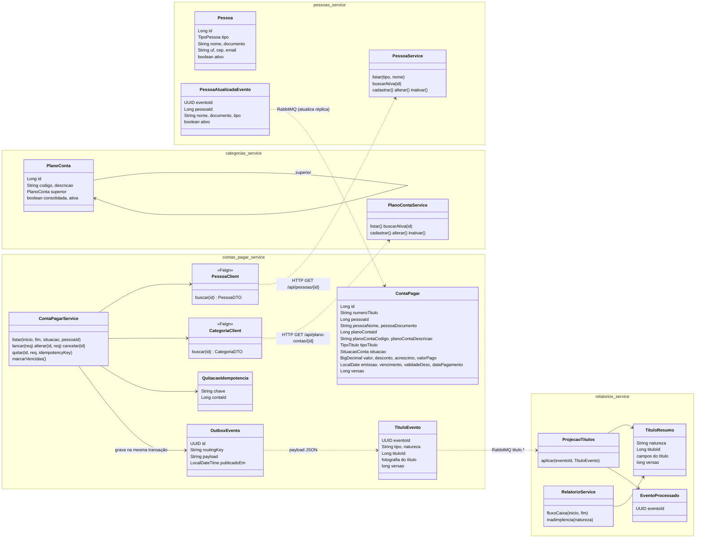
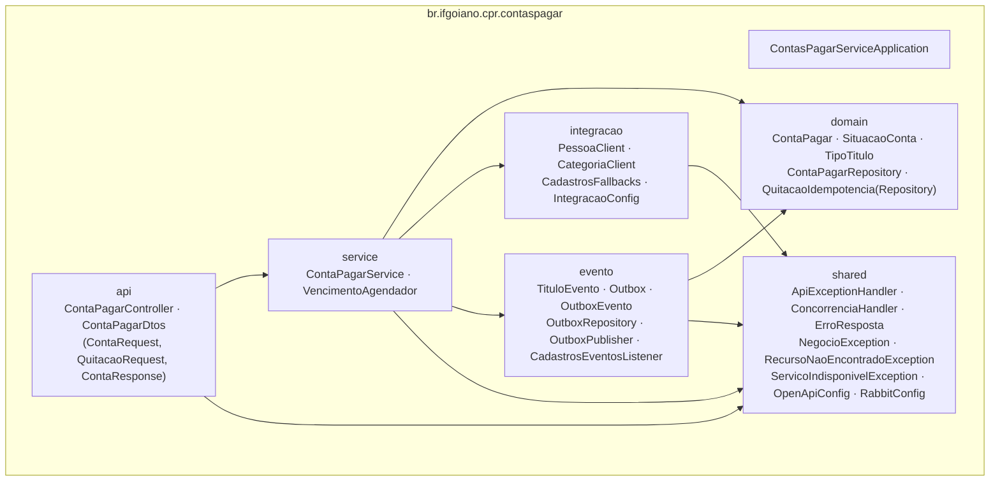
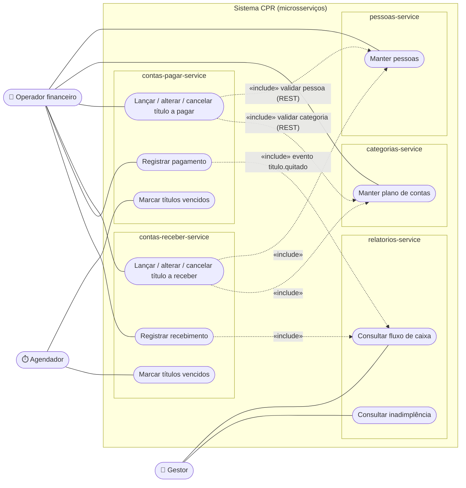
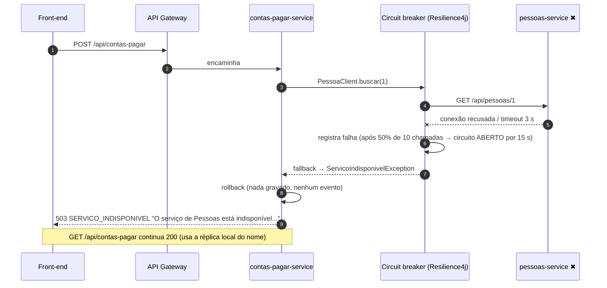
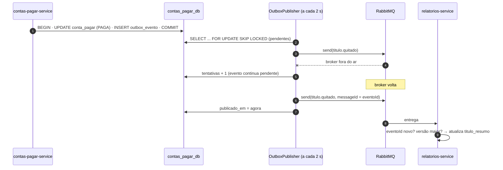
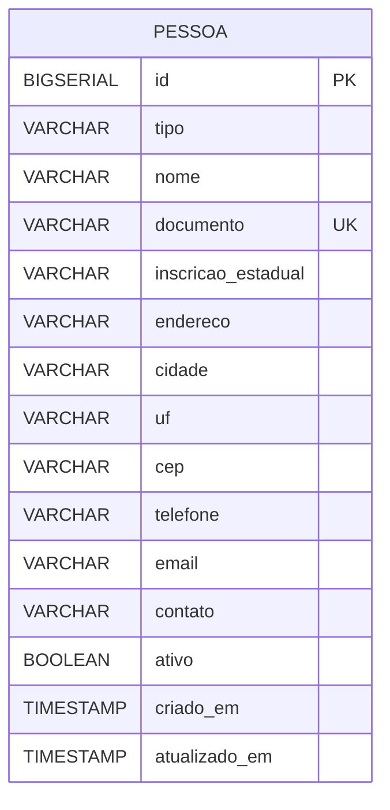
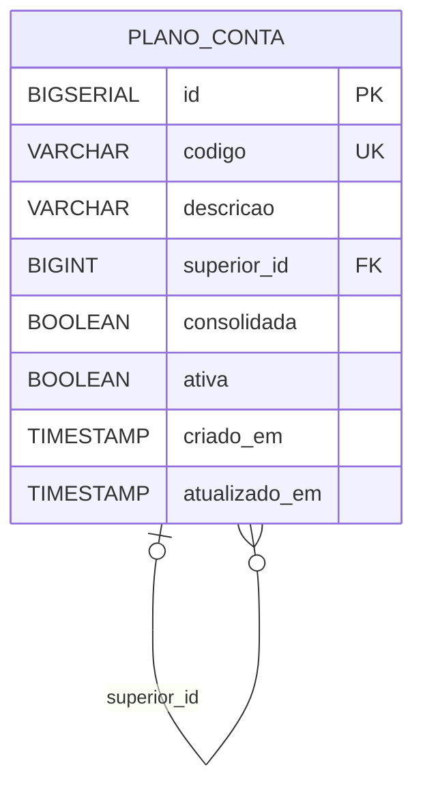
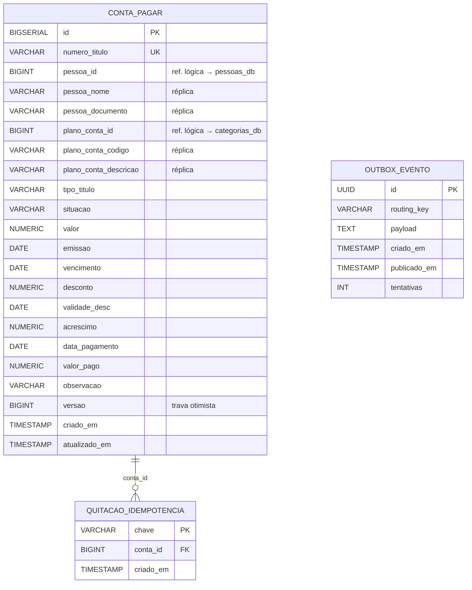
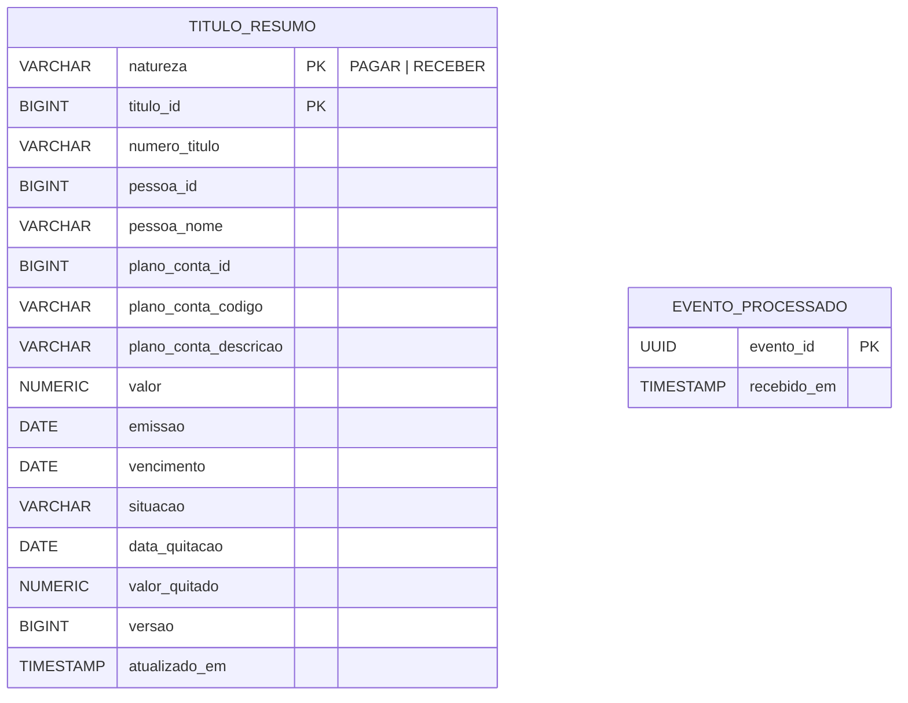

# Diagramas — Arquitetura de Microsserviços (etapa 2)

A visão geral da arquitetura e o diagrama de comunicação estão nas seções 9 e 13 da [documentação](DOCUMENTACAO.md).

## 1. Diagrama de classes (por serviço)

Cada serviço tem as **próprias** classes; não há biblioteca compartilhada. As linhas tracejadas entre serviços são contratos de rede (REST ou evento), não referências Java.

O `contas-receber-service` tem exatamente a mesma estrutura (`ContaReceber`, `dataRecebimento`, `valorRecebido`, rota `/recebimento`).

## 2. Diagrama de componentes

```mermaid
flowchart TB
    subgraph Cliente
        NG["frontend<br/>Nginx + React :3000"]
    end
    subgraph Plataforma
        GW["api-gateway :8080<br/>Spring Cloud Gateway<br/>Resilience4j · Retry · Swagger UI"]
        EU["discovery-server :8761<br/>Eureka"]
    end
    subgraph Negócio
        PS["pessoas-service :8081"]
        CS["categorias-service :8082"]
        CP["contas-pagar-service :8083<br/>Feign · Resilience4j · Outbox · Scheduler"]
        CR["contas-receber-service :8084<br/>Feign · Resilience4j · Outbox · Scheduler"]
        RS["relatorios-service :8085<br/>consumidor de eventos"]
    end
    subgraph Infraestrutura
        PG[("PostgreSQL 16 :5433<br/>pessoas_db · categorias_db · contas_pagar_db<br/>contas_receber_db · relatorios_db")]
        MQ{{"RabbitMQ :5672 / :15672<br/>exchange cpr.eventos · DLX cpr.eventos.dlx"}}
        ZK["Zipkin :9411"]
    end

    NG -- "/api/** (proxy)" --> GW
    GW -- "lb://" --> PS & CS & CP & CR & RS
    GW & PS & CS & CP & CR & RS -. "registro / descoberta" .-> EU
    CP & CR -- "Feign (REST)" --> PS & CS
    PS & CS & CP & CR & RS --> PG
    PS & CS & CP & CR -- publicam --> MQ
    MQ -- entrega --> CP & CR & RS
    GW & PS & CS & CP & CR & RS -. spans .-> ZK
```

## 3. Diagrama de pacotes

Todos os serviços de negócio seguem a mesma organização interna (exemplo: `contas-pagar-service`):

| Serviço | Pacotes |
|---|---|
| `pessoas-service` | `api` · `service` · `domain` · `evento` · `shared` |
| `categorias-service` | `api` · `service` · `domain` · `evento` · `shared` |
| `contas-pagar-service` / `contas-receber-service` | `api` · `service` · `domain` · `integracao` · `evento` · `shared` |
| `relatorios-service` | `api` · `domain` · `evento` · `shared` |
| `api-gateway` | `gateway` (configuração de rotas em YAML + `FallbackController`) |
| `discovery-server` | `discovery` |

## 4. Diagrama de casos de uso

## 5. Diagramas de sequência

### 5.1 Lançamento e quitação (caminho feliz, com idempotência)

Ver seção 13 da [documentação](DOCUMENTACAO.md#13-comunicação-entre-os-serviços).

### 5.2 Lançamento com o serviço de pessoas fora do ar

### 5.3 Entrega de evento com o RabbitMQ fora do ar (outbox)

## 6. DER — um banco por serviço

Não há chaves estrangeiras **entre** bancos. `pessoa_id` e `plano_conta_id` nos títulos são referências lógicas, validadas por REST na gravação e acompanhadas de uma réplica de nome e código.

pessoas_db

categorias_db

contas_pagar_db — o `contas_receber_db` é idêntico, com `conta_receber`, `data_recebimento` e `valor_recebido`.

relatorios_db — modelo de leitura montado só por eventos.
