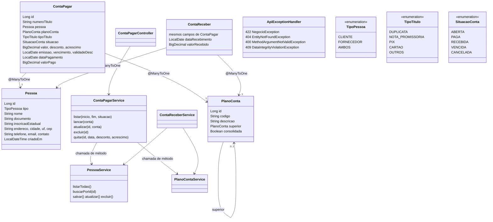
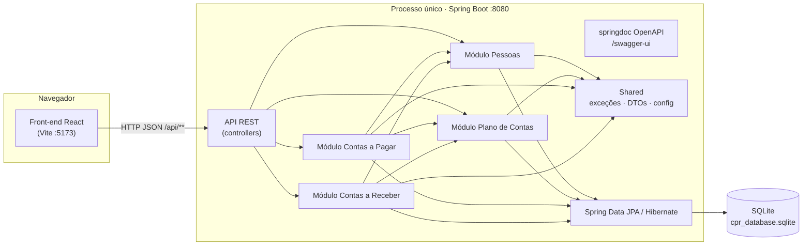
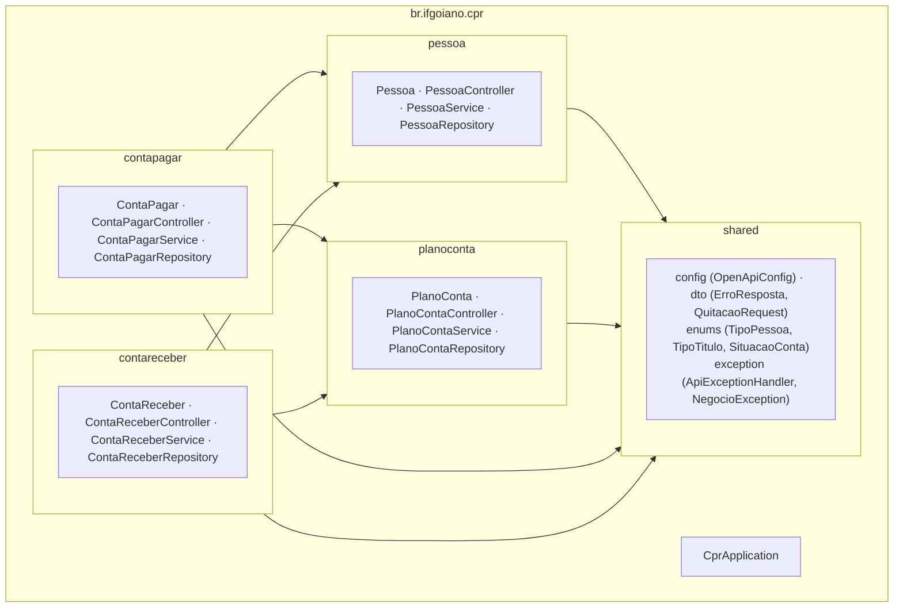
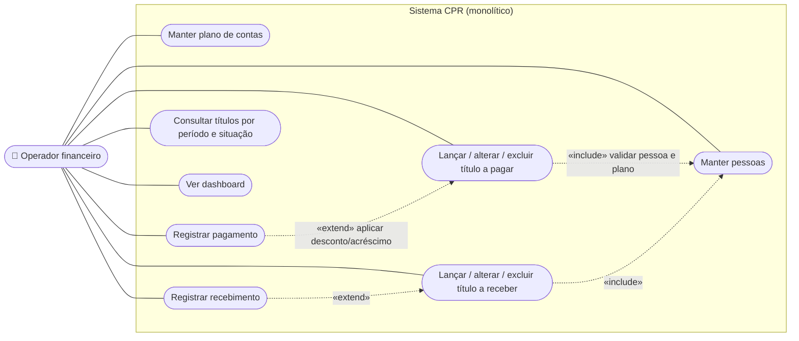
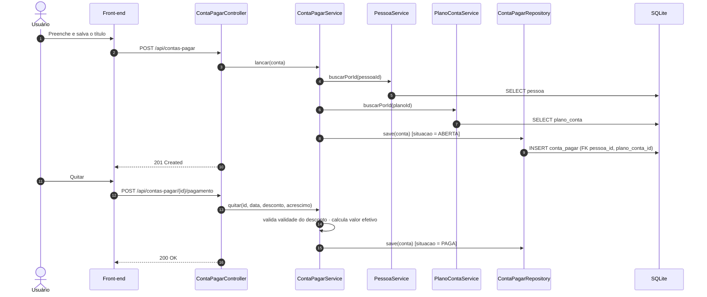
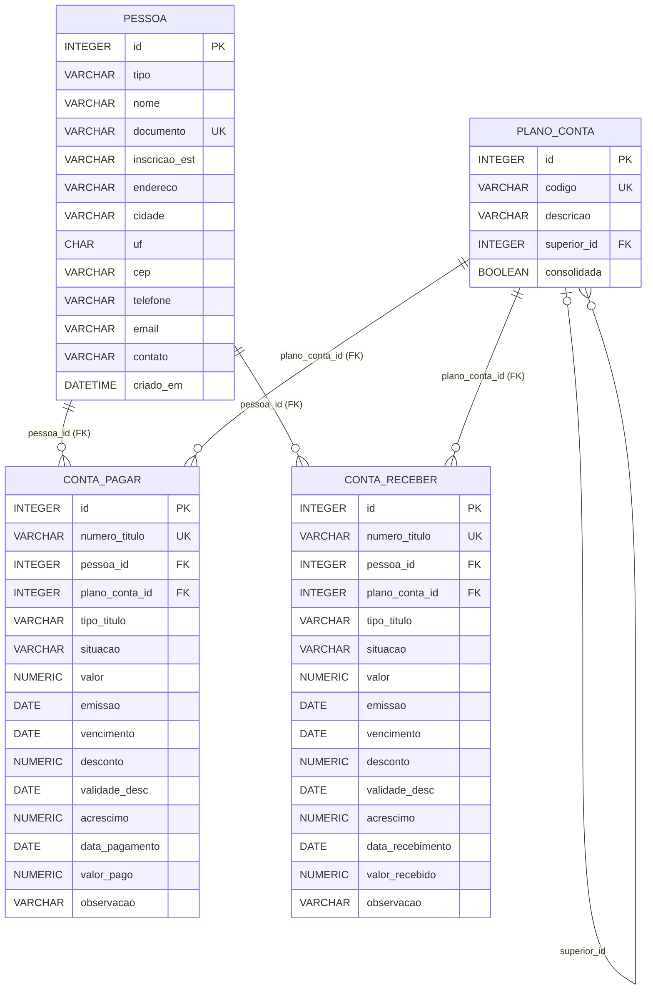

# Diagramas — Arquitetura Monolítica (etapa 1)

Versão monolítica: repositório https://github.com/guilherme22112/contas-a-pagar
(Spring Boot 3.3 · Java 21 · SQLite · React). Pacote base `br.ifgoiano.cpr`.

## 1. Diagrama de classes

## 2. Diagrama de componentes

## 3. Diagrama de pacotes

O pacote é organizado **por domínio**: cada pasta de primeiro nível virou um microsserviço na etapa 2.

## 4. Diagrama de casos de uso

## 5. Diagrama de sequência — lançar e pagar um título

## 6. DER do banco de dados (SQLite)

